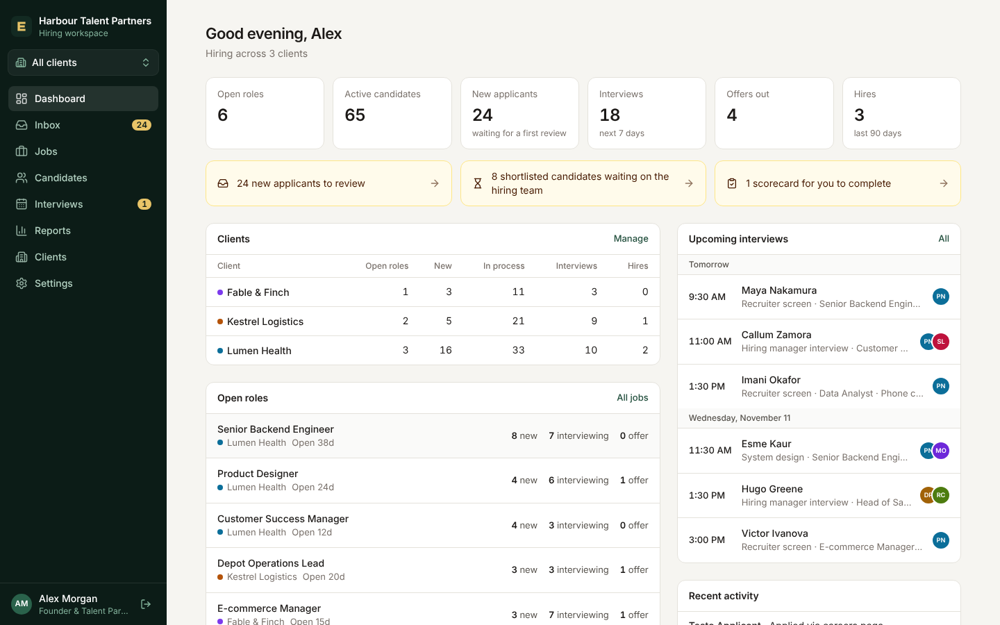

# The Book

A hiring workspace for an embedded recruitment agency: one place to run inbound applicants, pipelines,
interviews and reporting for every company you work inside, with a login for each client's hiring team.

Your agency name is set at first sign-in and shown throughout the workspace.



## What it does

| Area | What you get |
| --- | --- |
| **Clients** | Each company you embed in has its own jobs, candidates, hiring-team logins, brand colour and engagement terms (retainer, fee per hire, or both). A switcher scopes the whole workspace to one client or all of them. |
| **Careers pages** | Every client gets a public, branded careers page at `/careers/<client>` listing open roles, each with an application form (résumé upload, custom screening questions, consent). Link to it from the client's website. Add `?src=linkedin`, `?src=job_board` or `?src=referral` to an apply link to track where applicants came from. |
| **Jobs on our website** | Your agency's own public job board, in your name, for the jobs you choose to advertise yourselves without saying who the employer is. Each post is written for the purpose and checked for anything that would give the client away before it can go public. Link to the board, show it inside a page of your own website, or read it as data. See [Jobs on our website (confidential posts)](#jobs-on-our-website-confidential-posts). |
| **Recruiter brief** | Each job opens on a brief for your recruiters: about the role, must-haves, nice-to-haves, who is not a fit, companies and places to look, job titles and keywords with a ready-made search string (one click to search LinkedIn or Google), pay and room to move, your fee, selling points, first-call questions and process notes. The person who created the job (or an admin) edits it; the rest of the team reads it; clients never see it. |
| **Job board** | Every job has an account executive: the person on your team who created it. The dashboard has a board with a column for each account executive and their jobs under their name, each with how long it has been open, how many openings are filled and how many people are in its pipeline, at interview and at offer. Agency only. See [Account executives and the job board](#account-executives-and-the-job-board). |
| **Job autofill** | When adding a job, paste or drop in the client's job description and your intake call notes or transcript, and the job and its recruiter brief are filled in for you to review. With an Anthropic API key connected, Claude drafts everything, including the brief from the call. Without one, the details a job description states outright are picked up (title, location, salary, requirement lists). |
| **Otterview** | Every call with a candidate in one place, in two tabs. **Metaview**: the conversations your agency records in Metaview, findable and on the right candidates, each opening with its transcript and Metaview's notes. **Record a live conversation**: record a call in the browser, or upload a recording, and it is written out with who said what. Either way a notes summary is there and one click drafts the write-up for the hiring team. Agency only. See [Otterview](#otterview) and [Metaview in Otterview](#metaview-in-otterview). |
| **To do** | Each person on your team has their own list: the jobs they have picked to work on, the people to prep before an interview and the people to debrief after one. Jobs and people are dragged across from a picker, or added with a button; The Book adds people by itself from the interviews scheduled in it. Agency only. See [To do](#to-do). |
| **Inbox** | Every new application across all clients lands in one review queue, oldest first. Candidates somebody on your team has asked you to review are there too, under **For your review**. See [Asking for a review](#asking-for-a-review). |
| **Pipeline** | A drag-and-drop board per job with stages you define. Ratings, notes (optionally agency-only), rejection reasons, withdrawals, offers. |
| **Shortlist hand-off** | Submit a candidate to the hiring team with your write-up. They approve (the candidate moves to the next interview stage) or decline with a reason, so you can calibrate. |
| **Interviews** | Schedule with a panel, download a calendar file, and collect a structured scorecard from each interviewer against the criteria set on the job. Outstanding scorecards are chased in the sidebar and dashboard. |
| **Email** | Templates with merge fields; every message is recorded on the candidate. Application confirmations, interview invitations and rejections can be sent automatically. |
| **Reports** | Funnel conversion, source effectiveness, weekly application volume, time to hire, open-role ageing and hires. Printable for client reviews. Your retainer and placement-fee revenue is shown to your agency only. Two more reports for your agency alone: each recruiter's submissions, interviews and placements, and each client's searches, fill rate, time to fill and billings. See [Reporting](#reporting). |
| **Access** | Agency admins and recruiters see every client. Client users see only their own company, and never see your fees, internal brief or agency-only notes. |
| **Accounts** | Send a one-time invitation link (from a client's page or Settings, Team) and the person sets their own password. Or people can use "Create an account" on the sign-in page to ask for access: nothing is granted until you approve the request and choose which client's hiring team it joins, and the person then sets their password from a one-time link sent to the address they gave. |

## Accounts and getting back in

- **Invitations.** A link works once, for 7 days, and can be tied to one email address. It stops working if the
  person who created it is deactivated (their unused links are removed), and a link that grants agency access
  also needs its creator to still be an admin.
- **Account requests.** "Create an account" on the sign-in page takes a name, email, company and job title, and no
  password. A request cannot sign in and is not an account. When you approve it, it becomes an invitation tied to
  that email address: with email connected the person is sent the link, otherwise you are shown the link to pass
  on yourself. Either way the password is chosen by whoever opens the link, not by whoever filled in the form.
  Requests nobody answers are removed after 14 days, and sign-up pauses while 200 are waiting.
- **Forgotten password.** Deactivate the account (Settings, Team), then invite the person again at the same email
  address. Accepting that invitation brings the same account back with a new password and the access chosen on
  the invitation; everything it did before stays attributed to it. Only an invitation tied to that exact address
  can do this.
- **Someone has left.** Deactivate them. They are signed out everywhere, their unused invitation links stop
  working, and candidates they own stay under their name (shown as deactivated in the owner filter) until you
  reassign them.

## Who counts as the same person

Within one client, a person is recognised by their **email address**, or failing that by their **LinkedIn profile
link** (`linkedin.com/in/<name>`, stored in one form however it was copied). No other link identifies anyone: a
GitHub page, a personal site, a company's team page, a LinkedIn Recruiter or Sales Navigator address and the old
`linkedin.com/pub/...` form are kept for reference only, because many people can share one.

- Adding someone whose email or LinkedIn link is already on a record at that client adds them to that record
  (and says so) rather than creating a second one.
- If the LinkedIn link is on a record with a plainly different name, nothing is merged: you are shown the
  existing record and asked to open it or check the link.
- The public application form never joins an applicant to an existing record by link, since anyone can type any
  link there. If the link matches someone already on file, both records are kept, each profile shows
  "Possible duplicate", and an agency user can merge them. Merging moves every application, note, interview and
  email onto the record you keep.

## People in The Book without a job

A person can be saved to The Book with no job chosen, from the Chrome extension on their profile or from Add
candidate in the app, and put on a job later when the right role comes up.

- **What they have.** Everything on a profile that does not need a job: an owner, a résumé, a photo, notes, e-mails
  to them, calls in Otterview (recorded, uploaded or brought in from Metaview), Edit details and Delete candidate
  data. Stages, rejecting and withdrawing, the hiring team, interviews, offers and ratings belong to a job, so each
  of those answers "Add them to a job first."
- **Metaview.** A conversation in Metaview is matched to somebody who is on no job the same way as to anyone else
  (their e-mail address, their number, their exact name), shows "Not on a job yet" where the job would be, is
  offered on their profile's Calls tab, and with "bring calls in by themselves" on arrives on their entry unasked.
  Deleting them forgets their Metaview conversations too.
- **Where they are.** On the Candidates page, under their own tab, "Not on a job yet", which shows how many there
  are; "Everyone" lists them with everybody else. The other tabs (In process, Hired, Rejected, Withdrawn) are about
  a pipeline and leave them out, so "In process" shows the same people the dashboard's "Active candidates" counts.
  The search at the top of every page opens "Everyone", so it finds them too while the menu shows all clients. They
  are in no job, client, pipeline board, inbox, dashboard figure or report, nor in the pipeline a card on the job
  board drops down until they are put on that job, and a list for one client or one job never contains them. They
  belong to the agency: client users never see them, and their notes are always agency-only.
- **Who counts as the same person.** Among people saved without a job, the same rules as within a client: one
  record per e-mail address, or failing that per LinkedIn link. Saving somebody again adds what was sent to the
  entry they have and makes nothing new. An address or a link that is on an entry under a plainly different name
  is put to you instead, so one person's résumé, photo and note never land on another's entry.
- **Résumés are never written over.** When somebody who already has a résumé is saved again with another, the new
  one goes on their profile and the one they had is kept under "Earlier résumés" there, for the agency to download
  under the name it was uploaded with, accents and other alphabets included. The same file sent twice is kept
  once. Earlier résumés are deleted only with the person.
- **Putting them on a job.** Their entry becomes that job's application at the stage chosen (the first stage if
  none is), and keeps its notes, résumé, calls and history. The date they entered the job is the day they were put
  on it, so time to hire is not counted from the day they were first saved. The client's hiring team sees the
  application from that moment on: nothing written or sent while the person was on no job is shown to them, nor
  the date they were first saved. That is not left to a filter. At the moment they go on the job, the history and
  the e-mails from before it are moved off the application into tables only the agency is read from, their notes
  are all agency-only, and a covering note saved with their entry becomes an agency-only note ("Saved with their
  entry in The Book: ..."). Your own view of the profile is unchanged: the whole history, every e-mail and note.
  An e-mail is recorded when the mail provider has answered, which can take seconds. One sent from The Book that
  is still on its way when the person is put on a job is recorded in the agency's own table as well, with the
  moment it was sent; if their entry was folded into another application meanwhile it is recorded there, and if
  the application was deleted meanwhile nothing is recorded.
  Put straight into an interview stage, Offer or Hired, they are picked out in Recent activity on the dashboard
  as anyone added straight into that stage is. Recent activity holds the job's news only, for you as for the
  client: nothing from before the job is listed beside the job's name. If they go back to The Book and are later
  put on another job, what happened on the first job stays in their history, for the agency only, and is neither
  shown to the second job's hiring team nor listed under the second job.
- **However you add them, it is the same entry.** "Add to a job" on their profile, choosing a job in the
  extension, and Add candidate in the app with a job chosen all do this, so somebody who was in The Book does not
  end up with a second record. Add candidate and the extension recognise them by e-mail address or LinkedIn link
  when the name agrees; typed under a different name ("Bob" for "Robert"), or with only a link when their entry has
  none, they are not recognised and are added as somebody new, so add them from their profile when in doubt. Found by their link with a different e-mail address typed, their entry keeps
  the address it has and the history says which one was typed (for the agency only), as it does for a client's
  record. The other way round, "No job yet" for somebody who is already on a client's job shows you where they
  are instead of saving them a second time ("already in your workspace"). That is the screens' doing: Add candidate
  and the extension look the person up first. If the look-up fails they are saved, and each profile then points to
  the other (see "One person, more than one record" below).
- **When the client already has a record of them.** From their profile you are asked whether to join the two; from
  Add candidate and the extension, which add to the client's existing record anyway, the entry is joined to it.
  The entry then moves onto the client's record. Where the two disagreed (another e-mail address, phone number,
  location), the client's record keeps its own, and the history says what the entry had, for the agency only. If
  the client's record is already in the job you chose, "Join this entry to that record" folds the entry into the
  application they have there: its notes stay agency-only and its history and e-mails go to the agency's own
  tables, so the hiring team is never shown them. What the hiring team does see from the entry is what their
  record was missing: contact details, a photo, and the résumé if the application had none (a second résumé is
  kept as an earlier one, for the agency). The dialog says so before you join.
- **If the job is deleted, or they are removed from it,** somebody who was in The Book before goes back to The Book
  without a job, with their notes, résumé, e-mails, calls and history, including what was added while they were on
  the job. Only what belonged to the job goes: interviews and scorecards, the offer, the rating, the write-up for
  the hiring team and the hiring team's review of it. Everyone else in a deleted job is deleted with it, as before.
  A note a client user wrote stays on the entry as the agency's; that user can no longer delete it, and is told
  the same as for a note that does not exist.
- **What they wrote to one client never reaches another.** Somebody may have applied on a client's careers page
  themselves and then been joined with their entry in The Book. When that application goes back to The Book, the
  answers they gave to that client's questions, their note to that client and the consent they ticked there are
  taken off it and kept as one agency-only note ("From their own application for ... at ..."), and its source
  becomes "Agency sourced". Put on another client's job afterwards, that client's hiring team is shown none of it.
  The résumé goes the same way. When the entry was joined to an application that had a résumé of its own, the
  entry's was set aside; back in The Book the entry has the résumé it brought again, and the application's own is
  kept under "Earlier résumés", which only the agency is given. When the entry brought none, a résumé the person
  sent that client with their own application is still taken off and kept under Earlier résumés (also the copy
  of it on another of that client's jobs they were added to, for as long as the application they made themselves
  is still on the client's record), and the entry goes back without a résumé. One case leaves the agency's own
  copy under Earlier résumés instead of on the profile: an application they made themselves without a résumé,
  which had been using the entry's.
- **What a hiring team could still work out.** Nothing from before the job is shown, but two things are as they
  are because the entry is kept and not copied: its history line reads "Added to (job) at (stage)", where somebody
  added straight to a job has "Added to the pipeline (...)" (the same line as for anyone added to a second job at
  the client); and the entry keeps its number, so its profile address can be lower than that of somebody added to
  the job before it, and is the same one it had at an earlier client.
- **One person, more than one record.** Each client keeps its own record of a person and The Book keeps its own,
  so the same person can be on file in two places: in The Book and on a client's record (they applied on a careers
  page while in The Book, or were removed from one of a client's jobs while still on another, which sends what you
  kept on the entry back to The Book as a record of its own), or at two clients. Each profile says so ("Also in
  The Book without a job", "Also on Maple Freight's record, in ..."), found by e-mail address or LinkedIn link,
  with a link to the other. Only the agency is told. "Delete all data on this person" names every such record and
  asks which to delete: the ones under the same e-mail address are ticked, one that only shares a LinkedIn link is
  left for you to tick, and everything ticked is erased together. A request to be forgotten is only done when
  every record of them is gone.
- **Somebody already on a job** can be added to another job of the same client the same way, as a new application
  with a copy of their résumé. Each client keeps its own record of a person, so for a job at another client they
  are added as a new candidate.

- **The reports.** Somebody on no job is in neither report. Put on a job, they are counted like anyone in that job:
  a submission, a first interview with the client and a placement are each written down once, and put straight into
  Hired they are a placement. When they go back to The Book (removed from the job, or the job deleted), what was
  counted for them in that job goes, as it does when anyone else is removed from a job; on their next job they
  are counted afresh, for that job.
- **To do.** Somebody on no job has no interview to be prepared for or debriefed after, so they are never offered
  beside the two people lists (not by the search either), and putting them on one is refused ("Add them to a job
  first"). Put on a job, they are on those lists like anyone in that job: an interview scheduled for them puts them
  on the To prep list of the recruiter who owns their entry, or failing one of whoever put them on the job. When
  they go back to The Book (removed from the job, or the job deleted), they come off everybody's To prep and To
  debrief lists for that job, ticked items included, and the count in the menu follows; what was typed at a debrief
  stays on their profile as the agency-only note it was saved as. An invitation sent to them, or sent again when
  an interview is edited, is an e-mail like any other sent after they joined the job: the job's hiring team can
  read it and the line in the history that says what was changed, and both become the agency's own, with the rest,
  if they later go on another job.
- **Asking for a review.** Somebody on no job can be put to anybody on the team with "Ask for AE review" like
  anyone else. Nobody is suggested, since there is no job and so no account executive, and the request is in the
  Inbox of whoever is asked whichever client the menu shows. Put on a job, or back in The Book, their requests stay
  with them; when two entries are merged, or an entry is joined to a client's record, the requests go to the one
  that is kept (a second open request to the same person is cancelled, and shows as cancelled in the history). See
  [Asking for a review](#asking-for-a-review).
- **Jobs on our website.** A confidential post (see "Jobs on our website" below) and The Book are kept apart the
  same way a client's careers page and The Book are.
  - *Somebody in The Book who applies through a post, or on a client's careers page,* is answered exactly as anybody
    is: the same answer from the form and the same confirmation, so the form cannot be used to find out who is in
    The Book. Nothing is joined: the client gets a record of its own made from what they typed, their entry in The
    Book is not touched, and each profile points to the other for the agency ("Also in The Book without a job").
    The hiring team is shown what they sent and nothing the agency holds. If you then join the entry to the
    application they made, the rule above applies: their note, their consent and their résumé stay on the
    application as theirs, and the entry's notes, history, e-mails and résumé are kept where only the agency
    reads. They are still somebody who came through the post and has not been told who the client is.
  - *One address is sent three e-mails an hour at most* by the public forms, as before. What the agency sent
    somebody while they were in The Book counts towards that, wherever it is kept now.
  - *Put on a job that has a confidential post from The Book,* somebody who never applied through that post is on
    it like anyone the agency adds: the board has no record of them, the post's count of applicants does not
    include them, and what The Book sends them is in the client's name. If they then apply through the post
    themselves, the form answers as it does for anybody, and they are in the job once.
  - *Somebody who came through a post and goes back to The Book* (they were in The Book before and are removed
    from the job, or the job is deleted): what the board noted about their application belonged to that job and
    comes off it, namely the post, the title they saw and the "Knows who the client is" tick. The agency's own note
    on their entry says which post it was and whether they had been told ("They applied through your confidential
    post ... and had not been told who the client is"), with the note they wrote and the consent they gave; the
    source becomes "Agency sourced". Put on another client's job, or on another job of the same client, that
    job's hiring team is shown none of it, the tick is not offered, and e-mails are about the new job in its
    client's name.
  - *Put back on the same job,* they are the post's applicant again, as they were when they left it: somebody who
    has not been told who the client is, or somebody who has, with the tick as it was made. So what The Book sends
    them by itself uses the title they applied under and says "our client" again, an e-mail that would name the
    client all the same is held back, a hand-written one that names the client is refused until you have seen the
    warning, and "Knows who the client is" is there to tick. The post counts them among its applicants again, and
    their history says so in a line the hiring team is not shown.
    - *However they are put back:* "Add to a job" on their profile, Add candidate or the extension with the job
      chosen, and joining their entry to a record the client already has. It makes no difference if they were on
      another job in between, if their entry was folded into another entry in The Book, if the post has been
      switched off, or if it has been given another title (they are written to under the title they saw). Somebody
      who is on another of the client's jobs by then, and is added to the post's job from there as a second
      application, is the post's applicant on that one.
    - *Joined to an application that is already in the job:* if they applied for the same job on the client's
      careers page in the meantime, the entry is folded into that application, and they are still somebody who came
      through the post and has not been told. If the application was made through the post, the board's record of
      it stays as it is: it is the newer of the two.
    - *What is not put back:* the source stays "Agency sourced", because this time the agency put them on the job,
      and the reports count them under it. The note they wrote for the post, the consent they gave and the résumé
      they sent stay where going back to The Book put them: in the agency's note and under Earlier résumés. The
      hiring team sees somebody the agency added, with the résumé on their entry.
    - *Where it is kept meanwhile.* While they are away from the job, what the board had noted is set aside in a
      table of its own. Nothing reads it but the step that puts somebody on a job: no screen, list, report, feed
      or e-mail shows it to anybody, the agency included. It is deleted with the person ("Delete all data on this
      person" leaves nothing of it) and with the job, since the post goes with its job. When two entries in The
      Book are merged into one, that one keeps it; where each had something set aside for the same post, "has not
      been told" is the one that counts.
  - *E-mails.* An automatic e-mail that is held back because it would name the client, and a hand-written one
    that is refused until you have seen the warning, are recorded nowhere: not on the application and not in the
    agency's own table. One you send anyway makes the tick when it is delivered, on the application that came
    through the post; if the person has left that job by the time the mail provider answers, nothing is ticked and
    the record is the agency's own, as for any e-mail from before a job. Put back on that job later, they count as
    not told until you tick it; if they are back on it by the time the mail provider answers, the tick is made.
    An e-mail sent to somebody in The Book while their entry is being joined to an application they made through
    a post is recorded there for the agency only, and they still count as not having been told.
  - *"Our website" is only ever an application made on the board.* It cannot be chosen when saving somebody to
    The Book or when adding somebody to another of a client's jobs, and nobody in The Book carries it. Somebody
    the agency puts back on the job they once applied for through a post does not get it back either, although the
    board has its record of them again.

The first start after this was added changes the database in place: three columns stop being required, one empty
column is added to applications, four empty tables are added (earlier résumés, the history lines and e-mails only
the agency reads, and what the jobs page had noted about somebody who has gone back to The Book), and nothing else
about existing people or applications changes. The tables of history lines and e-mails that are there already
are not touched, and neither is anything the jobs page has noted. The two tables that are rebuilt for this keep
every index and trigger they had, including ones an earlier version made and this one no longer makes.
`test/pool-upgrade.test.mjs` builds a database with the code from before, fills it, upgrades it and compares every
row, id, counter, index, trigger and foreign key. "Before" is six releases, each kept word for word under
`test/fixtures/`: the one this was first built on (`before-pool/`, commit 5f16829), the one after it
(`before-pool-3f7b1a4/`), the one with Metaview and the reports in and phone calls and the calendar out
(`before-pool-6f279a9/`), whose database is one the release before it made and that it then opened and used, with
Metaview conversations and recorded report moments hanging off the two rebuilt tables, the one with the To do page
and interview editing (`before-pool-d1b664a/`), whose database is that one again with people's to-do lists
hanging off the rebuilt applications table, the one with jobs on the agency's website
(`before-pool-09368bb/`), whose database is that one once more with confidential posts and what the board notes
about the people who applied through one, which hangs off applications too, and the one with account executives
and the job board (`before-pool-f7c16e5/`), whose database is that one again with a job handed on to somebody else,
a job that belongs to somebody who has left and a job with no account executive. That last one's database code is
still the live release's: what went live after it (the new look, and a job's pipeline under its card on the job
board, b979c5f) did not change `server/db.js` or `server/links.js`, so it needs no folder of its own.

What a database must end up as is not written out by hand, and neither is what other features add. It comes from
three places:

1. **The releases from before, run as they are.** A copy is opened by the newest of them (whose database code is
   the live one), which shows what the releases in between do to the database: the tables, indexes, triggers and
   columns they add, the rows they add and the values they change.
2. **This change, by name.** Its own differences are applied to what that leaves: three columns that stop being
   required, one column, four tables and six indexes. So a database last opened by any of the six gets the
   releases it missed and this change in one start, and ends up the same whichever way it came. Everything the
   live release knows has to be exactly that afterwards: every table, index and trigger as it was written, every
   column, foreign key and id counter, and every row under its id with every value.
3. **A general rule for anything else.** Whatever today's code adds besides belongs to a feature newer than the
   live release, and may only be this: a table, made as it is in a database made new today, that is empty or
   holds only the rows the same table starts with in a database made new today; a column, after the ones that were
   there, that is empty or holds its declared default on every row from before; a row a database made new today
   also starts with; an index or a trigger. Nothing that was there may be altered. The tests' output names what
   was accepted under this rule. (An addition by this change that is missing from its own list would be taken for
   such a feature's: held to the same rule and named, not refused.)

Every test is also run on a database whose tables began at the first release, and a database made by the first
release's own code (`first-release/`) that nothing since has opened is upgraded too. The start is also cut off
before each of its steps in turn: every time nothing is lost or renumbered, no index or trigger is missing, and the
next start finishes the job. (That found two older steps which a cut at the wrong moment left undone for good: the
one that gives each candidate an owner, and the one that says which interview stages are the agency's own when the
reports' tick first arrives. Each is now saved in one piece. A database that has already been through a step is not
put through it again.) All of this was run on made-up databases, not on a copy of a live one, so take a back-up of
`DATA_DIR` before the first deploy.

**When another release goes live before this one ships,** add it as the newest "before". Nothing has to be listed:

1. Copy its database code word for word: `mkdir test/fixtures/before-pool-<commit>`, then
   `git show <commit>:server/db.js > test/fixtures/before-pool-<commit>/db.js` and the same for `links.js` (and
   for any other file its `db.js` imports).
2. Add one entry at the end of `BEFORES` in `test/pool-upgrade.test.mjs`: its name, the folder, the full commit,
   and `after:` the folder of the entry before it. If the release brought tables of its own, give it a `use`
   function that fills them (above all those that hang off candidates or applications, with a row removed again so
   that an id counter is ahead of its rows) and say in `leaves` the highest id each has then given out; with no
   tables of its own, `use: () => {}` and `leaves: {}`.
3. Run `npm test`. From then on what that release adds is held to exactly what its own code does (1), and no
   longer to the general rule (3). A test "the database code kept from before is the code that was released"
   compares the copy with git.

One thing to look at when merging such a release: if it adds a column to `candidates` or `applications`, see that
its `addColumn` comes before this change's own (`general_until`) in `server/db.js`, which is the order the two
arrive in on a database that release has already opened. The other way round, the order of the columns would
depend on which release opened the database first, and the tests say so ("the columns of applications").

Until that is done the tests still pass for a newer feature that only adds things, which is then held to the
general rule. One that also writes to rows that were there fails them until its release is added: account executives
did, because the first start gives each job that was there its creator.

**Before the first deploy, and if you ever go back.**

- **Room on the disk.** Rebuilding the two tables needs room for about one and a half times the size of `app.db`
  in all for the length of the first start, so free space of about half its size (a 115 MB database took 165 MB
  at the most, 50 MB more than it had). With less, the start fails and the log says that the disk is full ("The
  disk that holds ... is full, so the database could not be upgraded. No row has been changed or lost.", or
  SQLite's own "database or disk is full" when it runs out after the tables are rebuilt). No row is changed or
  lost either way (a table rebuilt before the disk ran out stays rebuilt, with the rows it had): the version
  before still starts on the database, and the next start with room finishes the job.
- **Two copies of the app on one data folder.** A host that starts the new container before the old one has
  stopped has both writing to the same database for a moment. This version waits up to five seconds for the
  other instead of failing with "database is locked", and two first starts at the same moment leave the database
  as one would have. The version being replaced by this deploy does not wait: anything saved in it during the
  moment the new one rebuilds the two tables (milliseconds on a small database, about half a second with 50,000
  candidates) can fail with "Something went wrong on our side" and should be saved again. Reading is not
  affected, and it does not happen on a host that stops the old container first, nor on any later deploy.
- **Treat this deploy as one-way once somebody from The Book has been put on a job.** The version before this one
  starts on the upgraded database and loses nothing by itself, but it does not know about people without a job:
  - They disappear from its lists, their profiles answer "Not found", looking one up finds nothing (so adding them
    again makes a second record), and new Metaview conversations with them are not matched. They are all there
    again when this version is back.
  - **Do not delete a job, or remove anybody from one, while rolled back.** The old version deletes everybody in a
    deleted job, including people who came from The Book, whom this version would have returned to The Book.
  - What the client's hiring team may not see stays unseen. Notes, history and e-mails from before the job, how
    somebody was matched, a covering note saved with an entry, and what somebody wrote to another client are not
    stored where the old version shows the hiring team from (see above), and `test/pool.test.mjs` reads the
    database with the old version's own queries to check it. Two dates are in what the old version sends a client
    user's browser about somebody who came from The Book, though neither is on its screens: the date the agency
    first saved them (as the date their record was made) and the moment they went on the job. On the old version
    the agency does not see the history and e-mails from before the job either, until this version is back;
    nothing is deleted.
  - If you must go back for longer than it takes to fix a start, the safe order is: on this version, remove the
    people who came from The Book from their jobs (they return to The Book, which the old version shows to
    nobody), then roll back.
  - Somebody who came through a confidential post and has since gone back to The Book, or on to another job, has
    no record on the board any more, so the old version does not take them for an applicant of that post either.
    What this version set aside for them is in a table the old version neither reads nor writes: it starts with
    the table there and leaves every row as it is (a row still goes when its person or its post is deleted), and
    this version finds them when it is back. Somebody who was put back on the post's job before you rolled back
    has the board's record again, so the old version keeps the client's name from them as this one does. The old
    version puts nothing back itself: do not add somebody who came through a post to that post's job again while
    rolled back, or they are written to in the client's name.
`test/pool.test.mjs` runs the rest against the real API and a stand-in for Metaview (and, where this meets the
agency's jobs page, a stand-in for the mail provider), on four ports: the fifteenth,
sixteenth, eleventh and twelfth from `ORACLE_TEST_PORT`, or four in a row from `POOL_TEST_PORT` when that is set
(`test/oracle-helpers.mjs` lists which test file uses which port, and a unit test checks that no two share one). `npm test` uses thirty-four ports in a row from `ORACLE_TEST_PORT` (3610 unless
set): `ORACLE_TEST_PORT=5080 npm test`. Node refuses to fetch from a few ports whatever is listening on them
(5060 and 5061 among them), so a base that puts one of the thirty-four on such a port, any base from 5027 to 5061 for
one, is refused before a test runs, with a sentence that says which base to choose instead.

## Account executives and the job board

Every job has an **account executive**: the person on the agency team the job belongs to. Whoever creates a job is
its account executive. The job's own pages say who it is ("Account executive: Priya Nair"), the Jobs page shows it
beside each job and can be narrowed to one person's jobs, and the job form has an **Account executive** field.

- **Handing a job on.** The account executive can hand their job to anybody active on the agency team, from the job
  form, and so can an admin, for any job. Nobody else can change it. An admin creating a job can make it somebody
  else's from the start; a recruiter's new job is always their own. Who created the job stays on record and is never
  changed.
- **What goes with it.** The recruiter brief belongs to the account executive: they and admins edit it, and the rest
  of the team reads it. Once a job is handed on, the brief is the new account executive's to edit, not its creator's.
- **The job board.** On the dashboard, for the agency: one column for each account executive, headed with their name,
  their initials and how many jobs they have, and under it a card for each job with its title, the client, how long
  it has been open, its openings and how many are filled, and how many people are in its pipeline, at interview and
  at offer. A click on a card drops the job's pipeline down under it: every stage in order, how many people are in
  it and who they are (the first eight of a long stage, newest first; "and 12 more" opens the job's Pipeline tab, which
  has everybody), and a click on a name opens that person's profile over the dashboard. The people are the ones the
  job's Pipeline tab shows, so somebody hired is under Hired, though the card's Pipeline number counts only those
  still in play. Another click folds it away, several cards can be open at once, and the arrow in the card's corner
  opens the job itself. Your own column comes first, then the others by name. The board shows open jobs;
  the switch **Include paused and draft** adds those (closed jobs are never on it), and it follows the client chosen
  in the menu. Somebody with no jobs in view has no column. In a wide window the columns sit side by side and scroll
  sideways when there are many, with the scrollbar or the two arrows in the board's heading; a column is never taller
  than most of the window, and a long one scrolls inside itself, so the rest of the dashboard stays close by. On a
  phone the columns are stacked and each folds away, with yours open to begin with, and a long column shows its
  first five jobs until you tap **Show all**.
- **Jobs with nobody.** A job whose account executive is not known is in a last column, **No account executive**,
  until an admin gives it to somebody (open the job and choose **Edit**). That is the jobs that were already there when account executives arrived and
  whose creator was not recorded, was a client's user or has been removed from the database; every other job that
  was already there was given its creator. Somebody who is deactivated keeps their jobs, and their column says
  "Deactivated", until the jobs are handed on.
- **Clients.** The client's hiring team sees no job board and is never told who a job's account executive is, or who
  created it.

## Asking for a review

You have a candidate you want one of your account executives to look at. Open their profile, choose **Ask for AE
review** from the **...** menu (it is also in the **...** menu beside **Open profile** on a call in Otterview), and
choose who. The job's account executive is chosen for you when there is one and it is not you; anybody else active on
the agency team can be chosen instead. A client's user, somebody deactivated, somebody whose account request is still
waiting and you yourself cannot be. Say what they should look at if you like ("What should they look at?").

- **One at a time for each person.** While somebody has a request about a candidate that they have not answered,
  asking them again about the same candidate is refused ("Priya Nair has already been asked to review ..."), also
  from the candidate's profile for another job. Asking a second person is fine.
- **Where it arrives.** In the Inbox of whoever was asked, under **For your review**, which comes first while it has
  anything in it: the candidate, the job and client (or "Not on a job yet"), who asked, when, and the note, oldest
  first. It follows the client chosen in the menu as the other tabs do, but people in The Book on no job are always
  listed. **Review** opens the candidate's profile. The count beside **Inbox** in the menu includes it, and the
  dashboard says "2 candidates for you to review".
- **E-mail.** With e-mail connected, the person asked is sent a short message ("Alex Morgan asked you to review a
  candidate") with the candidate's name, the job and client, the note and a link to the profile (when `APP_URL` is
  set). The request does not wait for it: if the message cannot be sent, the request is still made and the log says
  so. Nothing is sent to the candidate or to anybody at the client.
- **Answering.** At the top of the candidate's profile the person asked sees who asked, when and the note, and two
  answers, **Good to go** and **Not a fit**, with a comment if they like. Everybody else on the agency team sees a
  quieter line instead ("Waiting on Priya Nair's review, asked by Alex Morgan 2 hours ago"), and whoever asked, and
  any admin, can **Cancel request**.
- **The answer comes back.** It is in the Inbox of whoever asked, under the same tab ("Priya Nair: Good to go", with
  the comment), and is counted there until they press **Done**. Opening the candidate from it does not clear it.
- **History.** The profile keeps a short list of the reviews asked about the candidate: who asked whom, when, the
  note, the answer and the comment, and which were cancelled.
- **Somebody who can no longer answer.** If the person asked is deactivated, becomes a client's user or is removed,
  nobody can answer their open requests. The profile says so ("Priya Nair can no longer answer; ask somebody else"),
  and whoever asked, or an admin, can cancel the request and ask somebody else. If whoever asked is removed, the
  request stays and can still be answered; the answer then goes to nobody's Inbox.
- **What happens around it.** Deleting a candidate, "Delete all data on this person", removing them from a job
  (unless they go back to The Book) and deleting the job remove their requests.
- **Clients.** A client's user is never sent anything of this: not the request, the note, the answer, the count, nor
  who was asked. Every route of it answers them "Only the agency team can do this." Everything about a review is
  kept in one table of its own (`team_reviews`), which nothing else reads: no line is added to the candidate's
  history, e-mails or notes, and no column to their record. So if the app were ever rolled back to a version from
  before this, the client's hiring team would still have nothing of it to see; that version simply leaves the table
  alone. `test/reviews.test.mjs` runs all of this against the real API, with a stand-in for the mail provider.

## To do

Everyone on the agency team has a **To do** page, straight after Dashboard in the menu, with a count beside it of
what is still to do. The list is the person's own: nobody else sees it or can change it, not even an admin, and
client users have no such page.

There are three lists on it. Each is in the order its owner puts it in, and every item has a tick box.

- **Jobs to work on.** The jobs you have picked. Beside the list, **Open jobs** shows every open job with its client,
  how long it has been open and how many people are in its pipeline, with a search box and a client filter. Slide a
  job across by its grip, or press its **+**. A job can carry a short note ("find 5 more by Friday"), and its title
  opens the job. A job that is closed afterwards stays on your list and says so, until you tick it or take it off.
- **People to prep.** Candidates you need to prepare before an interview.
- **People to debrief.** Candidates you need to speak to after one.

Beside the two people lists, **People at interview** shows the candidates who are in an interview stage of an open
job: yours to begin with, everyone's if you switch, and the search box finds anybody by name whatever stage they are
at. Slide someone across, or press **To prep** or **To debrief**. A person can be on both lists. Each item shows the
candidate, the job and client, their stage, and the day and time of the interview when The Book knows one; their
name opens their profile and **Brief** opens the job's recruiter brief.

### What The Book adds by itself

Interviews scheduled in The Book fill the two people lists without anybody doing anything.

- From **seven days before** an interview starts, the candidate is on the To prep list of the recruiter who owns
  them in that job. If nobody on the team owns them, it is the person who scheduled the interview; if that was the
  client's hiring team, nobody's, until somebody takes the candidate on.
- Somebody The Book adds to To prep goes **above the first person on the list whose interview is later** than
  theirs, so tomorrow's interview is never at the bottom of a long list. The order you have put everybody else in
  is left alone. On To debrief a new person goes last: whoever has waited longest stays first.
- When the interview's **end has passed** (or a scorecard has marked it completed), the candidate goes on that
  person's To debrief list, and their prep comes off as done. In Done it says "Interview passed", so a prep The
  Book ticked is not mistaken for one you did.
- A **moved** interview keeps its items, which show the new time. Moved to more than a week away, the prep comes
  off the list and is back when the interview is a week away again. A **cancelled** interview takes its items with
  it, and so does rejecting or withdrawing the candidate. A person you added by hand stays on your list; only the
  time goes.
- An item The Book takes off is **set aside, not thrown away**. If the same interview brings it back (moved back
  within the week, set back to scheduled, the candidate handed back to you), it is the same item, with the note
  you wrote on it.
- One at a time: with two interviews in a week, the candidate is to prep for the next one, and to debrief once,
  about the latest.
- **What you took off, or ticked, is not put back** for the same interview. A later interview for the same
  candidate is a new one.
- If the candidate changes hands, the item The Book added moves to the new owner's list (a note the first owner
  wrote on it is theirs and does not go with it).
- Nobody is put on a debrief list for an interview that ended more than seven days ago, or before the day To do
  first ran on your workspace: the lists start with what is coming up, not with last month. The one exception is
  a break: if nobody opened The Book for a while (the office was shut), then the first time anybody does, everyone
  whose interview ended since it was last open goes on To debrief, up to a month back.

The lists are brought up to date whenever somebody opens the page or the menu is drawn, and at once when an
interview is scheduled, changed or cancelled.

### Ticking things off

A job or a prep is simply done. Ticking a debrief offers one box, **What did they say?** Whatever is typed there is
saved on the candidate's profile as an agency-only note, so the debrief is not lost in a to-do list; the client's
hiring team never sees it. The box can be left empty. It stays open, with your words in it, until The Book has
answered that they are saved, and the page only says "Saved on their profile" when they are. If the debrief had
already been ticked somewhere else (on your phone, before you typed it up on a laptop), what you typed is saved
all the same.

Done items move to **Done** at the bottom of their list, can be un-ticked, and leave the page after seven days (they
stay in the database). A prep or a debrief un-ticked after its interview has changed (held, cancelled, or moved to
a later time) stays on your list as your own item.

### Mouse, finger or keyboard

Rows are dragged by the grip on their left, with a mouse or with a finger, and a gap opens where the row will land.
Drag within a list to put it in a new order, from a picker into a list to add, and from a list back onto its picker
to take it off. The wheel or trackpad can be used to scroll while a row is held. Everything can also be done
without dragging: **+**, **To prep** and **To debrief** add; the up and down arrow keys move a row while its grip
has the focus, and so does the row's menu; **×** takes it off; the tick box takes Space. After each of these the
keyboard's focus stays where the work is (the next row, the next **+**), not back at the top of the page. In a
window under 1100 wide (a phone, a tablet, a small laptop window) the lists come first, at full width, and each
picker opens behind **Add jobs** or **Add people**.

Deleting a job or a candidate removes their items from every list. Merging two records of one person keeps them.

## Jobs on our website (confidential posts)

A client's careers page (`/careers/<client>`) advertises a job in the client's name. **Jobs on our website** is the other
public face: a board in your agency's name, at `/board`, listing the jobs you have chosen to advertise yourselves
without saying who the employer is. The two are kept apart on purpose. Nothing on the board comes from the client,
and nothing on a client's careers page mentions the board.

### A confidential post

Every job has a **Confidential post** tab (agency only; the client's hiring team has no such tab and is sent nothing
about it). On it you switch on **Post on our website (confidential)** and fill in what the public will see:

- a **title**, which starts as the job's title;
- a **location as it should be shown**, such as "Greater Toronto Area". It starts empty and is never copied from
  the client;
- the **working pattern and contract**, which are the job's own;
- whether to **show the salary range**, and whether to **round it** (85,000 to 105,000 is shown as 80,000 to
  110,000), which is how a new post starts;
- the **advert text**, written for the purpose;
- whether to **keep the job off the client's careers page** while the post is switched on. A new post starts with
  this ticked: the job is then advertised on your board only, and there is no second advert to compare it with.

That is everything the public is ever given about the job. The tab shows a preview drawn by the same code as the
public page, the post's public link, how many people have applied through it, and a history of when it went public
or came down and why. **Jobs, Jobs on our website** lists every post with whether it is public.

A post is public while three things are true: it is switched on, its job is open, and the check below finds
nothing. Switching it off, pausing or closing the job, or ending the work with the client takes it down, and its
address stays the same if it comes back. A post that **the check** took down comes back at a **new address**: what
was public at the old one had something in it that should not have been, and the old address then answers like one
that was never a post, so a copy kept by a search engine or a link preview no longer leads to the post. A recruiter
can also give a post a new address by hand ("Give it a new address"), for when a person spotted what the check
could not.

When the check takes a public post down, the admins and whoever last saved the post are **told by e-mail**, the
Dashboard shows how many posts are switched on but not public, and whoever made the change is told on the spot. A
client's own users are told nothing.

### Drafting the advert

With an AI key connected (the same `ANTHROPIC_API_KEY` as job autofill), **Draft it for me** sends the job's own
advert to the AI service and asks for it to be written again with everything that could identify the employer taken
out: the name and anything made from it, products and brand names, founders and other named people, addresses and
neighbourhoods, exact headcount or funding figures, awards, slogans, links, and unusual phrases that could be
searched for. The employer is described only in general terms ("a Series B health-tech company"), a step more
generally than the client's advert does; how big the employer is (customers, sites, staff, revenue) is left out, not
rounded; and an unusual title is replaced by the common one for the same job. A title you have already changed
from the job's own is kept. The client's name,
website and the names of its people are sent too, so that the service knows what to keep out. The draft lands in the
form, with a list of what was taken out; nothing is saved until you save it. A draft that has not come back after two
and a half minutes is given up on (`BOARD_AI_TIMEOUT_MS` changes how long). Without a key, you write the advert
yourself.

**The draft is a help, not the safeguard.** It is checked like anything you type.

### The check

Before a post can go public, and again whenever the post, the job or the client is changed, the title, the location
and the text are searched for:

- the client's **name**, and each **distinctive word** of it. Words that say what kind of company it is ("Health",
  "Logistics", "Group", "Inc") are not looked for on their own; the whole name always is. A word of two letters
  ("TD", "GM", "3M") is found where it is written in capitals or as the name has it. Also found: the name **without
  its last words** ("Royal Bank" for Royal Bank of Canada, "Canada Health" for Canada Health Group), its
  **initials** in capitals ("RBC", "TTC", "EY", and "TD" for Toronto-Dominion Bank), and a name without its final s
  ("Loblaw" for Loblaws);
- **other names you list for the client** on the tab (brands, products, short names). The list belongs to the
  client: every post for that client is checked against it, at once;
- the client's **careers address** (the part after `/careers/`), its **website** and the name in the website's
  address;
- the names of **everybody with a login at the client**, whether or not they still work there. The job's hiring
  manager is among them, unless the hiring manager is one of your own team, whose name gives no client away. A full name is found however it is written; a first name or surname on its own is found where it
  is written with a capital, because "may", "will" and "grace" are also ordinary words;
- the **domains of their e-mail addresses** (not the public ones such as gmail.com);
- **any link, e-mail address, phone number, hashtag or social-media handle at all**, whoever it belongs to.

Capitals and accents make no difference ("LUMEN", "Lümen"), a name broken up with punctuation or spaces is still
found ("L.u.m.e.n", "Lumen-Health", "L u m e n"), and so is a word of the name at the start or the end of a longer
one ("Lumens", "TeamLumen", "teamlumen") and, when it is six letters or more, anywhere inside one
("#lifeatbrambleworth"). Characters that cannot be seen (joiners, soft hyphens) are taken out of a post before it is
stored, so what is checked is what is shown. Look-alike letters from the Cyrillic and Greek alphabets and small
capitals are read as the letters they look like, and a word that mixes two alphabets is refused outright. Each
thing found is shown in a sentence that says what it is and where, and the check also lists what it looked for.

**A post that fails cannot go public, and a public post that starts to fail comes down** until it is fixed: a
client is renamed to a word that is in the advert, somebody whose name is in it joins the client's hiring team. This
does not depend on every screen remembering to ask: before anything is shown to the public, the posts that are
switched on are checked again if anything at all has been saved since the last look.

**Overruling a false alarm.** A client called North will be found in "North America". An admin can overrule a
word of a name, a short form of it or its initials where that is plainly a false alarm. It is recorded with their name and the date, shown on the tab,
and holds for that word with the same words either side of it only: "North" anywhere else in the post is found
again. A whole name spelt out, a link or an address can never be overruled.

**What the check cannot do.** It finds names and addresses. It cannot tell that "the company behind the city's
blue rental bikes" gives a client away, or that a street name does. Read each advert as a stranger would.

**Matching the two adverts.** A client's careers page and your board are at the same web address, so anybody who
suspects a client can put its careers page beside your board. A new post therefore keeps its job **off the
client's careers page** for as long as the post is switched on: the job is not listed there, and its address and
form there answer as they do for a job that is not open. The job page in the workspace says "Not listed on the
careers page", to your team and to the client's alike, and nothing more. Untick the box only when the client needs
the job on its own page too. The check then compares the two adverts, and **stops the post** when the title is the
same or when both show a salary range (the same figures, or yours rounded: the client's range sits inside it). It
**warns** when a sentence is shared word for word, and always that both are public: working pattern and contract
are the job's own on both, and both come down at the same moment when the job closes.

**Clients' careers pages and search engines.** While any post is switched on, clients' careers pages are sent
with a request to search engines not to list them, so that a search of your workspace's address does not set your
clients out beside the board. The pages work as ever for anybody given their link. An admin can switch this off in
Settings, Agency, Jobs on our website. `/robots.txt` lets search engines read the pages and the board's own data, and
nothing else under `/api`.

### The public board

- `/board` lists the public posts, newest first, with a search box and filters for location and working pattern.
  `/board/<token>` is one post, with its application form.
- A post's address is a **random token**. It is not the job's number and cannot be turned into it; no public route
  takes a job's number and returns a post, or the other way round.
- The pages and the feed are built from a **list of allowed fields**: the token, title, location, working pattern,
  contract, the salary range if you chose to show it (rounded, if you chose that), the day it was posted, and the
  text. Never the client, its
  colour or careers address, the job's number, who wrote the post, how many applied, or any other date.
- An address that was never a post, a post that is switched off, one that came down and one whose job was deleted
  all answer the same: "This role is no longer open."
- The pages tell search engines and link previews the board's name and the role, and each post carries job-posting
  data that gives **your agency as the organisation hiring** and says the employer is confidential.

### Applying, and what the candidate is sent

The form asks for a name, e-mail address, phone, LinkedIn profile, résumé and a note, and for agreement that your
agency may hold the person's details and share the application with the employer. Your **agency's privacy notice**
is linked beside it. The client's own screening questions and privacy notice are never shown there.

- The application lands on the job like any other, with the source **Our website**, owned by nobody until a
  recruiter takes it, and it is in the Inbox. "Our website" appears wherever sources are listed and in the reports
  (to the client's hiring team it reads "Agency website"), and it is only ever an application made on the board.
- **The client's hiring team sees the applicant on their job as they see any other**, as soon as they apply, and
  nothing about the post. Bear that in mind for a search the client's own staff are not meant to know about.
- The candidate's confirmation is **your agency's own** ("Thanks for applying through ..."), under the title on the
  post, and names nobody else. It is the template "Application received (our website)" in Settings; if an edit
  ever makes it name the client, the original wording is sent instead.
- Each such candidate has a tick on their profile, **Knows who the client is**, which starts off. While it is off:
  - what The Book sends by itself (the interview invitation, the "not moving forward" e-mail) uses the title they
    applied under and says "our client" where the company's name would be. If the finished e-mail would name the
    client all the same (an interview's location, an edited template), it is **not sent**, and whoever clicked is
    told why;
  - an e-mail a recruiter writes by hand shows a warning beside the send button when it names the client ("This
    candidate applied through your confidential post. This message names ..."), and the button becomes "Send
    anyway". Sent that way and delivered, the tick is made for you.
- Somebody already in the job who applies again on the board is answered exactly as a new applicant would be,
  confirmation included. Somebody who came through the board and then applies for the same job on the client's
  careers page (when it is on both) is answered there as a new applicant the first time, and as somebody who has
  already applied after that, exactly as for any other job. A different answer, or a different number of e-mails,
  would tell them which employer the post was for.
- Where a template says "The {{company}} hiring team" or starts a sentence with the company, the e-mail reads "Our
  client’s hiring team" and "Our client ...", in what The Book sends and in the e-mail window alike.
- Somebody who is in The Book without a job and applies here is answered like anybody else, and what is noted
  about an applicant here (the title they saw, the tick) stays with the job they applied for: it does not follow
  them back to The Book or on to another client's job, and it is theirs again if they are put back on that job.
  "People in The Book without a job" above says how the two are kept apart.

### Getting it onto your own website

The Book cannot put a page on a website it does not run, so the board is offered three ways. All three are under
**Settings, Agency, Jobs on our website**, each with a copy button.

1. **Link to it.** The board's own address, `https://<your workspace>/board`.
2. **Show it inside a page of your website.** A snippet to paste where the jobs should appear: a frame that shows
   the board, and a short script that sizes the frame to its contents, so the page scrolls as one. Visitors
   search, open a post and apply without leaving your page. No cookies are involved. The script also gives **each
   role an address on your own website**: your page's address with `?role=<token>` on the end opens that role, and
   the address in the browser follows the visitor from the list to a role and back, so a role can be bookmarked,
   shared and linked to. It brings the role, or the application form, into view clear of a menu fixed to the top
   of your page. And if the board has said nothing after eight seconds (your website is not on the list), it puts
   a plain link, "See our open roles", in place of the blank space.
3. **Read it as data.** `https://<your workspace>/board/feed.json`: every public post as plain JSON (`id`, `url`,
   `title`, `location`, `working_pattern`, `contract`, `salary`, `posted`, `text`), for a web developer who wants to
   draw the list themselves. Any website may read it. People apply at each post's `url`.

Once the board is showing inside a page of your website, paste that page's address into **Address of the jobs page
on your website** in the same setting. From then on a role's address is on your website: it is what "Copy link" on
a post gives, what the feed's `url` holds, and what search engines and link previews are told is the address of the
board and of each role.

The board's pages, and only they, may be shown inside another website's page, and only by the websites listed in
that setting (`otterbrook.ca` and `www.otterbrook.ca` to begin with). Every other page of The Book still refuses to
be shown inside any page. A page opened at a board address shows the board and nothing else, wherever a link in it
leads.

**The owner's steps**, once this version is live:

1. Open **Settings, Agency, Jobs on our website**. Check the name, add your logo and colour, paste the link to your
   agency's candidate privacy notice, and check that the list of websites holds the address of your website as
   visitors see it (with and without `www`). Save.
2. If the workspace is reached at a domain of your own rather than the host's, set `APP_URL` to it where The Book
   is hosted, so that links use it. (Railway's own address is detected by itself.)
3. On each job you want to advertise: open its **Confidential post** tab, write the advert or have it drafted,
   give it a location, list any other names the client goes by, deal with whatever the check finds, tick **Post on
   our website (confidential)** and save. Leave **Keep this job off the client's careers page** ticked unless the
   client needs the job on its own page as well. Read the preview as a stranger would.
4. On your website, add a page (or open your careers page) and either link to the board or paste the snippet:
   in Squarespace into a **Code** block, in Webflow into an **Embed** element, in WordPress into a **Custom HTML**
   block, in plain HTML anywhere in the page. Publish the page and look at the published page, not the editor's
   preview: the board should appear, and grow and shrink as you search and open a post.
5. Paste the address of that page into **Address of the jobs page on your website** and save, so that each role
   has an address on your website.
6. Send one application through it yourself and check that it arrives in the Inbox with the source "Our website"
   and that the confirmation e-mail reads as you want.

**A blank space, or only a link saying "See our open roles", where the jobs should be?** The page's website is not
in the list, so the board refused to show there. Open the published page, look at the address bar, and add the
first part of that address (for example `www.otterbrook.ca`) to the list. Site builders show a page from an address
of their own while it is being edited, so the board may not show in the editor. **Wix** shows pasted code from an
address of Wix's own at all times: on Wix, link to the board (way 1) instead.

### Before you rely on it

- The snippet was tried in Chromium, at computer and phone widths, pasted into a plain page with a menu fixed to
  its top, served from another address standing in for otterbrook.ca: the board showed, sized itself, listed,
  opened a role with its top in view, gave the role an address on that page which opened the role again when the
  page was reloaded, brought the form into view below the menu, and took an application inside the frame; the same
  page at an address that was not on the list showed the link in place of the board after eight seconds. **It has not been tried on Squarespace, Wix,
  Webflow or WordPress, on the real otterbrook.ca, or in Safari or Firefox.**
- "Draft it for me" was only run against a stand-in for the AI service, so read the first real drafts closely.
- A job on your board and on its client's careers page at once can still be compared by anybody who has both pages
  open: the working pattern, the contract and what the job is are the same. Keeping the job off the careers page,
  which is how a post starts, is the only thing that rules it out.
- Your board and your clients' careers pages share one web address. Somebody who knows a client's careers address
  there can see that it is a client of yours, as they could before the board existed.
- Whether search engines list the posts, and how link previews look in a given app, was not checked: the details
  are in the pages, in the form those services document.

## Reporting

The Reports page has three views for the agency: **Overview** (the funnel, sources and hires, as before),
**Individual** (one row per recruiter) and **Clients** (one row per client). The view is in the address
(`/reports?view=individual`, `/reports?view=clients`), so a report can be linked to, and each one prints. Client
users see the Overview only; the other two, and everything behind them, are refused to them.

### When counting starts

Individual and Clients count from **Monday 16 November 2026**, from the start of that day in Toronto. Nothing that
happened before that moment is counted, and "lifetime" means since then. Before that day the two views say when
counting begins and show no numbers. An admin can see and change the date at the top of either view. The numbers are
written down as things happen, so moving the date later hides what was recorded before it, and moving it earlier
cannot bring back anything from before counting first began. Once counting has begun, everything is written down
whatever the date is moved to, so moving it later and back again loses nothing. The day is read in Toronto time; set
`REPORTS_TIMEZONE` (for example `America/Vancouver`) to read it elsewhere.

Moments are only written down while this version is running. **It has to be live before the start date.** If it is
installed after that day, or the date is moved to a day already past, nothing between that day and the moment
recording really began is in the numbers, and both views say so under the date ("The Book began writing these
numbers down on ...").

Something first done before the start is not made up for by doing it again afterwards: a candidate first submitted
the week before is not counted when they are sent again, and neither is the interview that follows.

### What is recorded, and when

Each moment is recorded once for a candidate in a job, at the moment it happens, with the recruiter credited as
things stood then. Reassigning a candidate or editing a client's terms later changes nothing that was recorded.

- **Submission.** The first time a candidate is submitted to the client's hiring team, credited to the person who
  submitted them.
- **First interview.** The first interview with the client that a submitted candidate gets: whichever comes first
  after their submission, being moved into an interview stage ticked "Interview with the client" or having an
  interview scheduled in The Book. A candidate already sitting in such a stage when they are submitted counts at
  the submission. It is credited to whoever submitted them. A candidate interviewed without ever being submitted is
  not counted, and neither is a submitted candidate taken straight to Offer or Hired with no interview stage or
  scheduled interview in between.
- **Placement.** A candidate is marked hired, credited to the recruiter who owns them in that job at that moment
  (whoever submitted them, if nobody owns them). The fee recorded is the salary on their offer times the client's fee
  percentage at that moment; if the offer has no salary yet, the fee is worked out when the salary is added, still
  at the percentage recorded at the hire. An agency user can correct it on the hired candidate's profile, under
  Placement; saving it empty says there is no fee for this placement. A hired candidate who is moved out of Hired,
  rejected or withdraws stops counting. If they are put back in Hired, by any road, the same placement counts again
  exactly as it was: its date, its credit and its fee do not change, whoever moved the card and whatever has been
  edited since. The one exception is a hire undone within a day of being made (a card dropped on Hired by mistake),
  with no fee entered by hand: that is forgotten, and a later hire of the same candidate is recorded afresh. A
  candidate hired before counting started is never counted, however their card is moved afterwards.
- **Search opened.** A job becomes open for the first time (kickoff).

Deleting a candidate or a job removes what was recorded for them. Merging two records of one person keeps it.

Each interview stage on the job form has a tick, **Interview with the client**. It starts ticked, except on a stage
whose name contains "recruiter", "screen" or "agency", and the stages of jobs that already existed were given the
same starting values. Changing a tick affects candidates who reach the stage afterwards, not those already in it.

### Individual: one row per recruiter

For a period you choose: since counting started, this month, the last 30 days, the last 90 days or the last 12
months. Admins see everyone on the agency team who has anything recorded, and a totals row; a recruiter sees only
their own row. Click a column heading to sort by it.

| Number | How it is counted |
| --- | --- |
| Submissions | The recruiter's submissions recorded in the period. |
| Interviews | First interviews in the period for candidates the recruiter submitted. |
| Interview/Submission ratio | Interviews divided by submissions, both in the period, as a whole percentage (5 of 11 is 45%); a dash when there are no submissions. |
| Placements | Placements credited to the recruiter in the period. |

### Clients: one row per client

Above the table are two drop-downs: the metric to sort by, and **High to low** or **Low to high**. Clicking a column
heading does the same. Nought is a figure like any other: a client with no searches shows 0 and comes first in
"Low to high", and a client with placements and nothing billed shows 0 in its currency. A dash means there is
nothing to work the figure out from (a percentage of nothing, a time to fill with nothing filled, billings with no
placements); those clients are listed last either way.

| Number | How it is counted |
| --- | --- |
| Total reqs, lifetime | Searches opened at the client since counting started. |
| Total reqs, last 12 months | Searches opened at the client in the last 12 months (never reaching back before counting started). |
| Interview % | First interviews divided by submissions, across all of that client's searches. |
| Placement % | Searches filled divided by searches opened: the client's fill rate. A search is filled when every opening on it has been hired into. Only searches opened since counting started are included, so a placement on an older search adds to billings but not here. |
| Time to fill | The average number of days from a search opening to the day the offer was accepted (the day of the hire, when no accepted offer was on record), over the placements on searches that count. |
| Total billings, lifetime | The fees recorded for the client's placements since counting started, in the client's currency. |
| Total billings, last 12 months | The same, for placements in the last 12 months. |
| Average fee per placement | Total billings divided by the number of placements that have a fee recorded. |

Billings are placement fees only; monthly retainers are not included. When clients are billed in different
currencies, each amount is shown in the client's own currency, and sorting by billings or fees compares the figures
as written, without converting them; the page says so. A placement with no fee (the offer had no salary) is listed
under the table with a link to the candidate, until the fee is entered or saved empty to say there is none.

The Overview's "Your fee" column and "Placement fees" total use the same recorded fees, so the two views agree. A
hire from before counting started has no fee on record, and the Overview still estimates it from the client's terms
today.

The demo data (`npm run seed`) is the one exception to the start date: so that the two views have something in
them, the demo counts from a Monday about five months back and is loaded with the moments its made-up history
would have recorded.

## Otterview

Otterview is where recruiters' calls with candidates are kept: the ones recorded in Metaview (see
[Metaview in Otterview](#metaview-in-otterview)) and the ones recorded or uploaded in The Book itself. This
section is about the second kind; once a call is in Otterview, both kinds work the same way.

1. **Record or upload.** A recruiter records the call in the browser, or uploads a recording made elsewhere (MP3,
   M4A, MP4, WAV, WebM or Ogg, up to 200 MB).
   A browser recording is sent to the server in small pieces during the call and each piece is saved as it arrives,
   so a dropped connection, a reloaded page or a restart of the server does not lose what was already recorded. A
   recording can run for 3 hours, counted from when it started. The recruiter is warned ten minutes before, and at
   3 hours the recording is stopped and saved; to carry on, they start a new one. An upload shows how far it has
   got and can be cancelled; it may take up to an hour to send.
2. **Transcript.** The audio is written out as text with the speakers told apart and a time on every turn.
3. **Notes.** A summary is drafted under headings a recruiter would use: background, why they are looking, relevant
   experience, pay, notice period, location, other processes, concerns to probe, next steps. Only what was said on
   the call goes in, and figures are kept as they were said. The recruiter can edit the notes and save them onto the
   candidate's profile as an agency-only note. If the notes cannot be written, the call says why and offers to try
   again; the recruiter can always write their own.
4. **Submission draft.** For a call that is on a candidate, one click drafts the write-up that goes to the client's
   hiring team. It is written to be read by the client: no fees, nothing copied from your private brief, no other
   clients, no names of other companies the candidate is talking to, nothing they said in confidence about their
   employer, and nothing personal (health, pregnancy or family plans, caring responsibilities, disability, age,
   religion, ethnicity, sexuality, immigration status): a gap or a need for flexibility is described neutrally. The
   notes mark such points "(personal: not for the client)". The recruiter reviews the draft before anything is
   sent, and once it has been sent the call says so and when.

A call can be recorded with no candidate chosen and added to one afterwards: the call's page and the list of calls
both have "Add to a candidate", which also offers to add someone who is not in The Book yet. A call put on the wrong
person can be moved: a title the call was given automatically changes to the new person's name, and the notes saved
on the first person's profile from that call are removed from it. Client users never see calls, audio, transcripts
or notes, or the line on a candidate's history that says a call was recorded.

### Two tabs

- **Metaview.** The agency's conversations in Metaview, newest first, with a search box and a few filters. Each one
  says which candidate it was with, or offers the people it might have been with. Opening one makes it a call in
  Otterview. See [Metaview in Otterview](#metaview-in-otterview).
- **Record a live conversation.** For a call on Meet, Zoom or Teams, on speaker, or in person: record it in the
  browser, or upload a recording made elsewhere. The calls recorded or uploaded in The Book are listed underneath.
  See [Recording a call](#recording-a-call).

A candidate's profile has a Calls tab with their calls of both kinds, in the order the conversations happened.

### Recording a call

- Press **Record now** on Otterview, or **Record a call** on the Calls tab of a candidate's profile, which starts
  with that person and job already chosen.
- By default only the recruiter's microphone is recorded. For a call held in Google Meet, Zoom or Teams in a browser
  tab, press **Add the other side of the call**, choose that tab and tick "Also share tab audio". For a call on a
  phone or in a desktop app, put it on speaker so the microphone hears both sides.
- A red strip with the time, Pause and Stop stays at the top of every page, so the recruiter can open the
  candidate's profile or anything else in The Book while the call is recorded. Stop pressed on Otterview opens the
  call; pressed from the strip anywhere else it saves the call and leaves the recruiter where they are.
- Closing or reloading the tab ends the recording; the browser asks first. Whatever had been recorded, up to the
  last few seconds, is saved the next time The Book is opened in that browser (or within about twenty seconds, if
  another tab of The Book is open there), and the call's page says it was cut off. If the connection drops, or the
  server restarts, recording carries on and the missing part is sent when the connection is back.
- Audio that has not reached the server yet is kept in the browser until the server has it. If that browser is
  away for more than a day, the server saves the call from what it has, and still takes the rest for a week after
  that: when the browser comes back, the call becomes the whole recording. If the browser is gone for good (another
  computer, cleared browsing data), the person who recorded the call, or an admin, can press **Save what was
  recorded** on the call's page.
- Several recruiters can use one computer: each person's unsent audio waits for them and is sent when they next sign
  in there.
- If the browser's own recorder stops working in the middle of a call, the page says so, saves the call up to that
  point and asks the recruiter to start a new recording.

### The two keys

| Setting | What it turns on | Without it |
| --- | --- | --- |
| `DEEPGRAM_API_KEY` | Transcription. The audio is sent to [Deepgram](https://deepgram.com), which returns the words with the speakers told apart. Create an account and an API key there. | Calls are still recorded, kept and played back. The recruiter can paste in a transcript (lines such as `Priya: ...` become speaker turns), and everything else works from that. |
| `ANTHROPIC_API_KEY` | The notes summary and the submission draft, written by Claude from the transcript. This is the same key job autofill uses. | Transcripts still work. The recruiter writes the notes and the write-up by hand. |

Claude cannot listen to audio, which is why transcription needs a service of its own. Optional settings:
`ORACLE_MODEL` chooses a different Claude model for Otterview (it otherwise follows `AUTOFILL_MODEL`, then
`claude-opus-5-5`); `DEEPGRAM_LANGUAGE` sets the language of the calls (default `en`); `DEEPGRAM_API_URL` points at
another Deepgram address, for example `https://api.eu.deepgram.com/v1/listen` to have audio processed in the EU.
A request for notes or a draft that gets no answer is given up on after three minutes and one more try
(`ORACLE_AI_TIMEOUT_MS` changes the three minutes); transcription is given up on after about five minutes and one
more try. Either way the call says what happened and can be tried again.

Recording needs the workspace to be served over HTTPS: browsers only allow the microphone on secure pages.

### Where audio is kept

Finished audio is a file in `DATA_DIR/uploads`, next to résumés and photos (its name starts with `call-`). While a
call is being recorded its pieces sit in `DATA_DIR/recordings`; they are removed when the call is stopped, or a
week after the server saved a call that was cut off (see above). Both are on the same persistent disk as the
database, so the back-up that covers `DATA_DIR` covers them. An hour of recorded speech is about 15 MB; uploads are whatever
size the file is. Transcripts and notes are in the database.

### What is sent outside your server

- **To Deepgram:** the audio of a call, once, when it is transcribed. Every request asks Deepgram not to keep the
  audio or transcript and not to use them to train its models (`mip_opt_out`).
- **To Anthropic:** the transcript, the notes, the recruiter's name, and the candidate's and job's details (name,
  current job, the advert, the must-haves and ideal profile from your brief). Your fee and the rest of the brief are
  never sent.
- **To Metaview:** only the key and the requests themselves (which conversations to list or fetch). Nothing about the
  candidates in The Book goes there. See [Metaview in Otterview](#metaview-in-otterview).

### Consent to recording

A call with a candidate is personal data, and in many places it is against the law to record a call unless everyone
on it has agreed. For a call recorded in the browser or uploaded, The Book does not announce the recording to the
candidate: the recruiter has to tell them and get their agreement. (A call brought in from Metaview was recorded
by Metaview, under whatever notice your Metaview account gives; The Book records that it came from there and asks
nobody to confirm anything.) Before every recording and every upload the recruiter must confirm that everyone on the call has
agreed, and the workspace stores who confirmed it, when, and the sentence they ticked. A recording cannot be started
without that sentence; an upload sent without one is recorded against the standard sentence ("Everyone on this call
knew it was being recorded and agreed."). Nothing is recorded or kept without that. Check what the law requires where you and your candidates are, and say in your privacy notice that
calls may be recorded and transcribed.

"Delete candidate data" on a profile also deletes that person's calls: the audio, the transcripts and the notes.
Merging two records of the same person moves their calls to the record you keep. A call can be deleted on its own
by the person who recorded it or by an admin. Nothing is deleted automatically after a set time: calls are kept
until someone deletes them, so decide how long you keep them and clear out older ones.

### What it costs

Both services bill the account whose key you set, per use. These figures are estimates gathered in November 2026,
not quotes; check the providers' pricing pages.

- **Deepgram:** its pricing page could not be read while this was built, and the published figures found elsewhere
  disagree. Plan for roughly $0.26 to $0.38 per hour of audio. Asking Deepgram not to keep or train on the audio,
  which Otterview always does, may put the rate up.
- **Claude:** an hour-long call is about 9,000 words. At the published price of `claude-opus-5-5` ($4 per million
  tokens read, $20 per million written) the notes for such a call should cost in the region of 10 to 20 US cents,
  and each submission draft about the same. This is worked out from the prices, not measured.

Each recruiter can ask for 40 AI drafts an hour, so a mistake cannot run up a bill.

### Before you rely on it

The transcription request follows Deepgram's published description exactly, but Deepgram could not be reached from
where this was built, so it has only been run against a stand-in that answers the way the description says. Before
going live, record a one-minute call with two people in Chrome and in Safari with a real key and check that the
transcript comes back with two speakers. The notes and submission drafts were likewise only run against a stand-in
for Claude, so read the first few real ones closely.

Recording was tested in Chrome only. Edge, Safari, Firefox and phones have not been
tried, and neither has a real call of an hour or more. The cases where a day or a week passes (the server saving a
call by itself, a browser coming back later with the rest) were run by putting the clock back, not by waiting.

## Metaview in Otterview

If your agency records its candidate calls in [Metaview](https://www.metaview.ai), Otterview can show them. The
Metaview tab lists every conversation Metaview has for you, puts each one on the candidate it was with, and opens
any of them as a call in Otterview: the transcript with the speakers named, Metaview's own notes as the notes
summary, how long it was, when it took place, and a link back to the conversation in Metaview.

From then on it is a call like any other. Speakers can be renamed, the notes edited or written again by The Book's
own AI, the write-up for the hiring team drafted, the summary saved on the profile, the call moved to another
candidate or deleted. The one difference is that there is no audio in The Book: to listen, follow the link to
Metaview.

### Connecting it

1. **Make a key in Metaview.** Sign in to Metaview, open **Settings**, then **Integrations**, then **MCP**. Where it
   asks "Use API Key instead of OAuth?", choose that, and press **Generate API Key**. Copy the key. A key belongs to
   the person who made it and sees what that person sees in Metaview, so make it with an account that can see all
   of the agency's conversations (an admin's).
2. **Enter it in The Book.** An admin opens **Settings**, **Agency**, and pastes the key into the **Metaview** card
   (the **Connect Metaview** button on Otterview's Metaview tab leads there). The Book tries the key against
   Metaview before keeping it: a key Metaview refuses is not saved, and the card says so. Recruiters see whether
   Metaview is connected, but only an admin can connect it, change the key or disconnect it.

That is all. Nothing needs setting on the server. If you would rather keep the key with the server's other
settings, set `METAVIEW_API_KEY` where The Book is hosted (on Railway: the service's **Variables**) and restart; it
then connects by itself. A key entered in the app takes over from one set on the server, and only a key entered in
the app can be removed in the app.

### What happens once it is connected

- **The list fills in.** The Book reads Metaview's list of conversations in the background, fifty at a time with a
  few seconds between pages, newest first. A couple of thousand conversations take two or three minutes. How far
  it got is kept, so a restart carries on from there. While it is still reading, the Metaview tab and the card in
  Settings say how far it has got ("600 of about 2,100 so far"); the calls already listed can be used meanwhile.
- **New calls appear by themselves.** Every ten minutes The Book looks for new conversations; **Look for new
  calls** looks at once. A recent conversation that has changed in Metaview (a transcript that arrived later, a corrected name) is
  brought up to date at the same time, and once a week the whole list is read again, which also takes out
  conversations that have been deleted in Metaview and were never brought in.
- **Each call is matched to a candidate.** By an e-mail address of the person on the call, by their phone number,
  or by their exact full name. Capitals and accents do not count. Anything weaker (a first name on its own, part
  of a name) never chooses anybody: those people are offered, and a recruiter picks. A person chosen by hand
  always wins and is remembered. Interviewers, and anyone with a login to The Book, are never taken for the
  candidate. Metaview often knows somebody on a phone call only by a first name and their number, so in practice
  most calls are matched by the phone number on the candidate's record: a candidate with no number in The Book
  will usually have to be chosen by hand.
- **Phone numbers are compared however they were typed.** "(647) 555-0199", "647.555.0199", "647/555/0199 ext 4"
  and "+1 647 555 0199" are one number, and a box holding two numbers ("416-555-0183 / 647-555-0199") counts for
  both. The last ten digits are compared together with the country: the same ten digits in another country
  ("+44 …") are a different number. A number with nothing in front is taken to be a North American one.
- **Evidence that points two ways chooses nobody.** If the address on a call is one candidate's and its number or
  its exact name is another's, or if Metaview lists two people on the call who are two different candidates,
  nobody is chosen: they are all offered, the call is never brought in by itself, and it is listed on each of
  their profiles until a recruiter decides. Two people on file with the same number (a household) or the same
  address are told apart by the name on the call; when the name does not settle it, both are offered. The same
  person on file under two clients is matched to the record that is still in progress, if only one is.
- **A caller Metaview has no name for** goes by their phone number there, and so the call is listed as "Call with
  +1 647…" here. The number still matches them to their candidate, and once the call is on a candidate it, and
  the speaker in its transcript, carry the candidate's name.
- **Opening a call brings it in.** The Book fetches that one conversation's transcript and notes and makes the call
  in Otterview, on the candidate it was matched to (their most recent job in progress) or the one the recruiter
  chose. The candidate's history gets the line "Metaview call, 12 min", which client users never see. Opening it
  again opens the same call. The call belongs to the interviewer, if they have a login to The Book, and otherwise
  to whoever opened it.
- **Notes may follow a little later.** Metaview writes a conversation's notes the first time they are asked for,
  which takes about half a minute. The call opens at once with its transcript; the notes are asked for again by
  themselves (five times over about nine minutes) and appear on the page when they are ready. If Metaview never
  produces any, the call says so and the notes can be written in The Book.
- **A call with no transcript** in Metaview is still brought in, saying that there is none yet. If Metaview writes
  it out later, the transcript and the notes arrive by themselves.
- **Recent calls come in without anyone clicking.** With "bring calls in by themselves" on (it is on unless an
  admin turns it off), a conversation from the last 14 days, and every new one, that an e-mail address or a phone
  number ties to exactly one candidate, with nothing else about the call pointing anywhere else, is brought in and
  put on that candidate automatically. A match by name is never enough for that, nor is a number shared by two
  people on file, and older history is only listed until somebody opens it. No more than 50 calls a day
  come in this way (`METAVIEW_AUTO_PER_DAY` changes the number), so a mistake cannot fill the workspace, and a call
  somebody deleted is never brought back by itself.

The list can be searched by name, e-mail address, phone digits and title, and narrowed to the calls you took part
in (**Mine**: the ones where the e-mail address you sign in to The Book with is an interviewer's in Metaview), the
ones not yet in The Book, the ones with no candidate, or, on a candidate's Calls tab, that candidate's calls, each
with **Add** and all of them with **Add all**.

### It only reads

The Book never changes anything in Metaview. Of everything a Metaview key allows, the code can ask for exactly two
things, and refuses to send anything else: whose key this is (to check it and show the workspace's name), and the
list of conversations with chosen fields. It asks one thing at a time, pauses between pages, and tries again later
when Metaview is busy or not answering; a failure is shown as a sentence on the Metaview tab and never stops the
rest of The Book.

Asking for a conversation's notes makes Metaview write them if it has not already, as it would if you opened the
conversation there. That happens only for conversations that are brought in.

### What The Book keeps, and where

- **For every conversation Metaview lists:** Metaview's number for it and its link, when it took place, its title,
  type, channel (Phone, Zoom...) and length, whether it has a transcript, and the names of the people on it with
  their part in the call. E-mail addresses and phone numbers are kept only where they are used: the candidate's
  (or, when Metaview names no candidate, everybody's who is not an interviewer), to work out who the call was
  with, and each interviewer's e-mail address, for "Mine" and for whose call it is. An interviewer's own phone
  number is not kept, nor are the contact details of anybody else on a call that has a candidate. That is what is
  needed to list a conversation and to match it, and nothing more is kept. Addresses and numbers are used for
  matching and searching on the server and are not sent to the browser, with one exception: where the number is
  all Metaview has to call somebody by, it is shown as their name, as it is in Metaview.
- **For a conversation that has been brought in:** its transcript and notes, on the call in Otterview.
- **Never:** audio. Metaview does not give it out.
- **The key:** sealed with a secret that the server makes on first use and keeps in `DATA_DIR/server-secret`, beside
  the database. It is never shown again, never returned by the server and never written to a log. Back the data
  folder up as a whole; if the secret file is lost, the key simply has to be entered again. A key set on the
  server (`METAVIEW_API_KEY`) that cannot be a key, such as one pasted with a line break in the middle, is not
  sent anywhere: the Metaview card says that it needs setting again.
- **What is deleted is written over.** When the key is replaced or Metaview is disconnected, and when a candidate
  is erased, the old contents are overwritten in the database's files, not just marked as free space. A backup
  taken *before* that still holds them, and a key keeps working in Metaview until it is deleted there: to retire
  a key for good, delete it in Metaview too (Settings, Integrations, MCP).

Nothing about your candidates in The Book is sent to Metaview: matching happens on your server. When a recruiter
has the notes written again or a write-up drafted, the transcript goes to Anthropic like any other call's (see
[What is sent outside your server](#what-is-sent-outside-your-server)).

Everything is agency only: client users are refused on every route and see nothing of it.

**Erasing a candidate** ("Delete all data on this person", or removing somebody's only application) deletes the
calls that were brought in for them, and also what The Book remembered about their other Metaview conversations:
those leave the Metaview tab, the search and the profile lists, with the person's name, address and number. Only
Metaview's numbers for those conversations are kept, so that the next reading of Metaview's list does not put
them back; they stay off the list even if the person is added to The Book again later. The conversations
themselves are still in Metaview: delete them there too if they must go altogether. (Deleting a whole job removes
the people who were only in that job and their calls, but does not do this for each of them.)

An admin can **Disconnect** Metaview (Settings, Agency): that removes the key and everything remembered about
conversations that were never brought in, at once, even if The Book is in the middle of reading Metaview at that
moment. Calls already in Otterview stay, and still open. The same care is taken when the key is replaced by one
for another Metaview workspace: nothing of the first workspace's list is carried into the second.

### Before you rely on Metaview

The Book was built and tested against a stand-in that answers the way Metaview does (`test/metaview-standin.mjs`).
It was then run once against the real service, reading only, in November 2026: the key was accepted and the
workspace named, the newest hundred conversations were listed (a page of fifty took about a second), and one phone
call was opened: every line of its transcript was read into turns for its two named speakers, its length and date
matched, and Metaview's notes arrived by themselves about 35 seconds later. That run is also where it was seen
that most callers have only a first name and a number, and that a few go by their number alone.

What that one run could not show, so check it the first time you connect:

1. Enter the key and watch the count climb to about the number of conversations you have.
2. Open a few recent calls, among them a video meeting and a long call. Check both names are on the transcript, the
   times look right, and the notes arrive within a minute.
3. Check a few matches of each kind: a candidate matched by phone number, one by e-mail, one by name.
4. Look at the calls that came in by themselves, and at each candidate's history line.

Not known: what limits Metaview puts on how often it may be asked (The Book stays well below anything
reasonable), and whether asking for notes counts against anything in your Metaview plan. The key is tied to the
person who made it; if that person leaves Metaview, the tab will say the key was refused, and a new one is needed.

## Chrome extension

`extension/` is a Chrome extension for sourcing. On a LinkedIn profile (or a GitHub profile, or a company's team
page), click its icon: the person's name, title, company, location and profile link are filled in, you choose the
job and stage, and they are added to that pipeline with you as the owner. Or choose "No job yet: just add to The
Book" (the first choice under Job, and the one a new install starts on): the person is saved without a job, and
you add them to one later from their profile (see
[People in The Book without a job](#people-in-the-book-without-a-job)). The choice is remembered, as the last job
is, and the popup works in a workspace that has no jobs yet. It warns you when the person is already in the
workspace, and does not save someone to The Book twice. When the person is already in The Book without a job and
you choose a job, the entry they have is put on that job and what you typed is added to it, in one step: their
notes, résumé, calls and history come with them and no second record is made. If the workspace refuses (a
colleague added them a moment ago, say), nothing is saved and the popup shows how things stand now. It only reads
the page when you click it, and only talks to your workspace, using the sign-in you already have there.

Everyone on the team can download it from Settings, Browser extension, which also has the four install steps
(Chrome, Load unpacked). `npm run build` packs the folder into that download. To offer it through the Chrome Web
Store instead, zip the folder and submit it from a Chrome developer account.

**It does not update itself.** Loaded from a folder, an installed copy stays as it is until it is replaced. After
a release that changes the extension (0.4.0 added "No job yet"), each person downloads it again from Settings,
Browser extension, unzips it over the old folder, and presses the reload arrow on "The Book" at
`chrome://extensions`; the workspace address is kept. 0.5.0 also has the photo fixes that went out as 0.3.1 (the
picture is taken only from the profile that was read, and permission is asked for only when the picture could not
be read at all). From 0.5.0 the popup compares itself with the copy the
workspace has ready and says so across the top when it is behind. A copy from before that cannot say anything, so
tell the team when you deploy. An older copy keeps working in the meantime: it has no "No job yet" choice, but
choosing a job for somebody who is in The Book still moves their entry, because the workspace does that itself.

It also copies the person's profile photo (untick "Save their profile photo" to leave it out). The picture is
cropped to a small square and stored in your workspace, so nothing is loaded from LinkedIn afterwards. Chrome
sometimes will not let the extension read the picture; the popup then shows an "Allow profile photos" button,
which asks Chrome once for access to LinkedIn's picture server. Photos show on pipeline cards, lists and the
candidate's profile, and can be added, changed or removed under Edit details. Client hiring teams see them too
unless you switch that off in Settings, Agency (some companies prefer to review candidates without photos, to
keep appearance out of the decision). A photo is personal data: it is deleted with the candidate.

On LinkedIn Recruiter, Sales Navigator, search and company pages there is no stable member link, so the link
field is left empty there: paste the person's public profile link. The first time it connects, the extension
confirms which workspace it is talking to.

LinkedIn changes its page markup from time to time. The reader has fallbacks (it was tested against signed-in,
public and renamed-class versions of a profile page), and every field can be corrected before saving, but if a
field stops filling in, `extension/extract.js` is the one file to adjust. LinkedIn's terms restrict tools that
extract data from its pages; this one only copies what is on the screen of the profile a recruiter has opened,
one person at a time, when they click.

## Run it

Requires Node.js 22.13 or newer.

```bash
npm install
```

```bash
npm run seed
```

```bash
npm run dev
```

Open http://localhost:3000. `npm run seed` loads a demo agency with four fictional clients; skip it to start
empty, in which case the first visit asks you to create your owner account.

Settings are read from real environment variables, or from a `.env` file in the project folder if you create one
(copy `.env.example` to `.env` and edit it).

Demo sign-ins (password `demo1234` for all):

| Who | Email | Sees |
| --- | --- | --- |
| Agency owner | `alex@harbourtalent.example` | Everything |
| Recruiter | `priya@harbourtalent.example` | All clients, no team admin |
| Recruiter | `marcus@harbourtalent.example` | The same; there so that the job board has a third column |
| Client hiring manager | `maya@lumenhealth.example` | Lumen Health only |

Public careers page for the demo: http://localhost:3000/careers/lumen-health

The demo's own job board: http://localhost:3000/board. It has two confidential posts. One is for a client called
North, whose advert says "North America": the job's Confidential post tab shows the word overruled by an admin.

To wipe the database and reload the demo: `npm run seed -- --reset`. This deletes every record, invitation link and uploaded résumé
in `DATA_DIR`, so it refuses to run when `NODE_ENV=production` unless you add `--force`.

## Put it online

The app is a single Node process with a SQLite database file, so it runs on any host that offers a
persistent disk (Render, Railway, Fly.io, a small VPS).

```bash
docker build -t the-book .
```

```bash
docker run -p 3000:3000 -v the-book-data:/data the-book
```

### Railway

1. Create a service from this GitHub repository. Railway builds it from the `Dockerfile`.
2. Attach a **Volume** to the service with the mount path `/data`. Without it, the database and résumés are wiped on every deploy.
3. Add a service variable `PORT` = `3000`, then generate a public domain for the service pointing at port 3000.
4. Open the domain. The first visit asks you to create your owner account.

Railway, Render and Fly.io are detected automatically, so rate limits apply to each visitor's real address.
On any other host that puts a proxy in front of the app, set `TRUST_PROXY=1` (or `2` if a CDN sits in front as well).

The `Dockerfile` deliberately has no `VOLUME` instruction, because Railway rejects builds that contain one.

### Any host

- **Persistent storage is required.** The database, résumés and recorded calls live in `DATA_DIR` (`/data` in the container).
  Without a mounted volume they are lost on every redeploy. Back this folder up.
- **Serve it over HTTPS** (every host above does this for you) and point a domain at it, for example
  `hiring.youragency.com`. Careers pages then live at `hiring.youragency.com/careers/<client>`.
- **Connect AI drafting (optional)** by setting `ANTHROPIC_API_KEY` (create one at console.anthropic.com). Job autofill
  then sends the job description and intake notes a recruiter provides to Anthropic's API to draft the job and brief,
  billed to that account per use. It uses `claude-opus-5-5`; set `AUTOFILL_MODEL` to use a different Claude model.
  A draft that has not come back after two and a half minutes is given up on and the basics are filled in instead
  (`AUTOFILL_AI_TIMEOUT_MS` changes how long). Without a key, autofill still works in its basic form and nothing is
  sent anywhere. The same key lets Otterview
  write call notes and submission drafts.
- **Connect call transcription (optional)** by setting `DEEPGRAM_API_KEY`. See [Otterview](#otterview) for what is
  sent, what it costs and what happens without it.
- **Connect Metaview (optional)** in the app: an admin pastes a Metaview key under Settings, Agency, Metaview. Nothing
  needs setting on the server, though `METAVIEW_API_KEY` works too. See [Metaview in Otterview](#metaview-in-otterview).
- **Tell the app about proxies.** Leave `TRUST_PROXY` unset when the app is reached directly (plain `docker run`).
  Behind a reverse proxy set it to the number of proxies in front, or sign-in and application rate limits will
  either lump every visitor together or be trivially bypassed.
- **Connect email** in one of two ways (see `.env.example`). Until you do, emails are saved on the candidate's
  record and clearly marked as not sent.
  - `RESEND_API_KEY` and `MAIL_FROM`: sends through [Resend](https://resend.com)'s web API. Use this on Railway,
    whose Hobby plan blocks SMTP. Create a Resend account, verify your sending domain there, create an API key,
    and set `MAIL_FROM` to an address on that domain, for example `Your Agency <hiring@youragency.com>`.
  - `SMTP_URL` and `MAIL_FROM`: sends through any SMTP server. With email connected, admins are also emailed
  when someone requests an account, and people are emailed their link to set a password when their request is
  approved. Set `APP_URL` to the workspace's address (Railway is detected automatically): without it the app
  does not know its own address, so it emails no link and shows it to the approver instead.

### If your workspace had the calendar or the phone line

Earlier versions of The Book could read a recruiter's calendar from a link they pasted in, and had a phone line
with a mobile number and a PIN for each recruiter. Both were taken out. Starting the new version never deletes
anything, so a database that was in use before still holds what people saved for them: each saved calendar link
(sealed, but such a link opens that person's whole calendar), what was remembered about their calendar events, and
their mobile numbers and PINs. Nothing reads any of it any more, and nobody can remove it from inside the app any
more. To clear it, run this once where The Book is hosted (on Railway: open a shell on the service, in `/app`):

```
node server/forget-removed.js          # says what is there and changes nothing
node server/forget-removed.js --yes    # clears it
```

It can be run while the app is running, clears only those four things (written over, not just marked as deleted),
and leaves every call in Otterview alone, phone calls included. Anyone who had saved a calendar link can also
reset their calendar's private address with their calendar provider, which makes the old link useless everywhere.

## How it is built

```
server/
  index.js   Express server; serves the API and the built front end
  api.js     All API routes: auth, careers pages, jobs, pipeline, interviews, reports
  reporting.js  The Individual and Clients reports: the record of submissions, first interviews, placements and searches, and the day counting starts
  todos.js   To do: each person's own lists of jobs to work on and people to prep and debrief, and what interviews add to them
  board.js   Jobs on our website: the agency's confidential posts, the check that keeps the client out of them, the public board and its feed
  autofill.js  Drafting a job and its brief from a job description and intake notes
  oracle.js  Otterview: recording and uploading calls, transcription, notes and submission drafts
  metaview.js         Metaview in Otterview: the key, reading the list in the background, bringing calls in
  metaview-client.js  The connection to Metaview: one request at a time, read-only, and the reading of its answers
  match.js   Which candidate a conversation was with: by address, by phone number, by exact name
  webm.js    Writes a browser recording's length into the file, so the player can seek
  db.js      SQLite schema and helpers (Node's built-in node:sqlite, no native modules)
  links.js   How profile links are stored, and which ones identify a person
  mail.js    Optional SMTP delivery; every email is logged either way
  secret.js  The server's own secret, kept in the data folder; seals the Metaview key
  seed.js    Demo data
  forget-removed.js  Run by hand: clears what the calendar and the phone line (both taken out) left in an older database
src/
  App.jsx, state.jsx, lib.js, ui.jsx   App shell, data hooks, helpers, shared components
  components/                           Candidate profile, modals, forms, layout
  oracle/                               What Otterview's screens share with the rest of the app (the recorder)
  pages/                                One file per screen, plus the public careers pages and the agency's public job board
```

Security basics in place: salted scrypt password hashing, HTTP-only same-site session cookies, every
request checked against the signed-in user's client, rate limiting per visitor on sign-in, sign-up,
invitations and public applications, a content security policy, résumé uploads restricted by type and size and only
ever served back as downloads, length limits on everything the public form accepts, and a honeypot field on
application forms. No page may be shown inside another website's page, except the agency's job board inside the
websites the agency lists. The code was reviewed by independent reviewers across authorization, web security, server
logic, front end and deployment, and the confirmed findings were fixed.

Candidate privacy: each application records when consent was given, each client can link its own privacy
notice from the form, and "Delete candidate data" on a profile erases the person's record, every application
they made at that client, their résumé files, and their recorded calls with the audio, transcripts and notes.

## Not built yet

- Calendar integration (Google or Microsoft) for live availability and automatic invites; today you get a calendar file to
  download for each interview.
- Calling a candidate from The Book. Calls are made the way you make them now and recorded by Metaview, or recorded
  in the browser.
- Playing a Metaview call's audio inside The Book; the call links to the conversation in Metaview.
- Self-service password reset by email. Until then, an agency user deactivates the account and invites the person
  again at the same address (see "Accounts and getting back in").
- Declining many account requests at once; each is declined on its own, and unanswered ones expire after 14 days.
- AI-assisted screening of applications. (Calls are summarised by Otterview; applications and résumés are not.)
- Joining a video call to record it. Otterview records in the recruiter's browser, or takes an uploaded recording
  (Metaview joins meetings itself, and those conversations arrive through the Metaview tab).
- Multi-posting to job boards, e-signature for offers, and headcount planning or onboarding checklists.
- Automated tests that drive the screens in a browser as part of `npm test`. `npm test` covers the résumé reader,
  job autofill (the plain reader, and the route against a stand-in for the AI service), the recruiter brief, the activity
  feed's milestones, résumé and photo files, Otterview's server side, Otterview's uploader, Metaview in Otterview
  against a stand-in for Metaview, starting on a database from before phone calls and the calendar were taken
  out, people saved without a job, and the database upgrade that made room for them. Otterview's recording screens were driven end to end in Chrome with a simulated microphone while they were
  built (record, reload and server restart mid-call, a lost connection, two people on one computer, transcript,
  notes, add to a candidate, draft, submit, delete), against stand-ins for Deepgram and Claude. The two tabs with
  Metaview were driven the same way at computer and phone widths against the stand-in for Metaview (connect, the
  history being read, search and filters, open, choose a candidate, draft and submit, a candidate's Calls tab,
  record, upload, a recruiter, a client user, disconnect). Reporting (every number on the Individual and Clients
  reports) is tested through a story acted out either side of the start date and over more than a year, with the
  reports' clock set by the test; the two reports, the start date, the placement fee on a hired candidate and the tick
  on the job form were driven in Chrome at 1280 and 390 wide on the demo data, and printed to PDF.
  To do is tested through a story acted out against the real server with the to-do clock set by the test (adding,
  ordering, ticking, the pickers, an interview scheduled, moved, cancelled and passed, the debrief note, one person
  against another's list, a client user, deletion and merging, and starting on a database from before it); where
  it meets people saved without a job (never on a list while on no job, on their owner's list once on a job with an
  interview, off every list when they go back to The Book, entries joined or folded, deleting) is in
  `test/pool.test.mjs` against the real server, with an edited interview's invitation and history line; the page
  was driven in Chrome on the demo data at 1280 wide with a mouse and at 390 wide with touch input, and with the
  keyboard alone at both widths. It has not been tried on a real phone, or in Safari or Firefox.
  Jobs on our website is tested through a story acted out against the real server with stand-ins for the AI and mail
  services (everything the check must and must not find, posts coming down, the exact fields the public is given,
  applying, every e-mail's whole text, which websites may frame which pages, and starting on a database made by the
  version before it); the agency's screens, the public board and the board inside a stand-in for the agency's
  website were driven in Chrome at 1280 and 390 wide on the demo data.
  The other screens were verified by hand.
